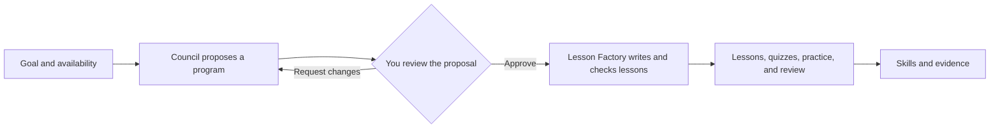
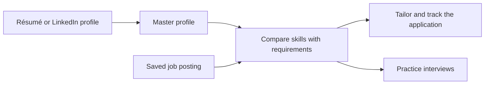
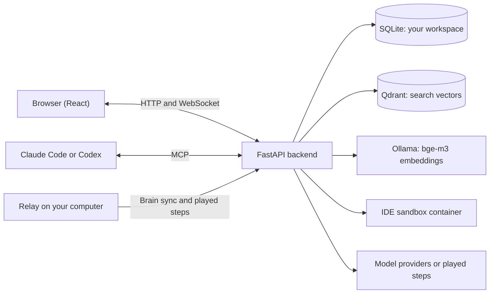
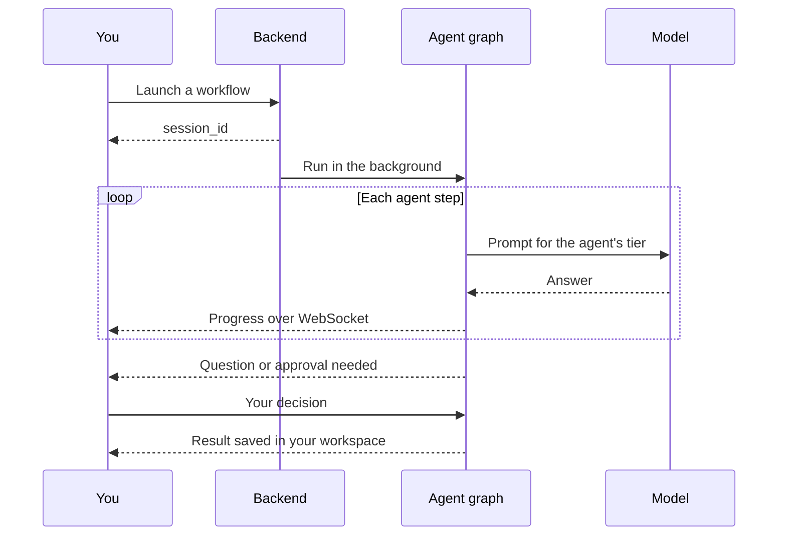
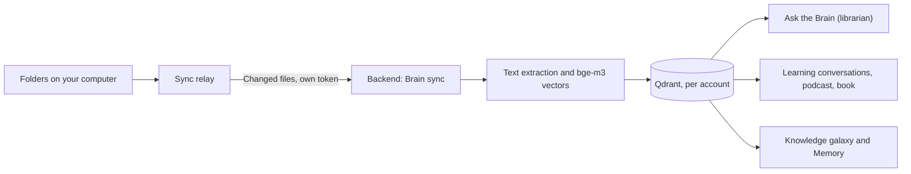

# Tremplin

Tremplin is a local learning and career platform powered by AI agents. It runs in Docker
and uses a React interface, a FastAPI backend, SQLite, and Qdrant. You can run it as a
personal workspace or enable Google sign-in to share an installation with a few people.

See the [product specification](SPEC.md), [decision log](DECISIONS.md), and
[implementation plans](docs/superpowers/plans/) for details. For moving to another
computer or restoring a backup, see the
[installation and migration guide](docs/INSTALLATION-ET-MIGRATION.md).

## What Tremplin does

### Turn a goal into a study plan

Set a learning goal and tell Tremplin when you can study. The Council works through
the options and proposes a program. Review the proposal, make changes, and approve it
when it fits. The Lesson Factory writes and checks lessons, and the program brings
lessons, quizzes, spaced review, and practical projects into a schedule. You can study
with the Tutor and track progress in the skills map.



### Practice coding and collect evidence

Use the built-in IDE to work through exercises and run your code in an isolated
container. An agent can review the exercise and propose a fix for you to inspect and
accept. Save practical projects and evidence of your skills in your portfolio. The
Brain keeps your notes and source documents searchable across sessions.

### Plan your next career move

Import a résumé or LinkedIn profile to build a master profile. Save a job posting from a
link or paste its text, compare its requirements with your profile, then prepare a
targeted application and practice for interviews. Tremplin keeps the original profile
and application work in your workspace so you can revisit them as your goals change.

On the postings page, **Ask about offers** opens your saved chats. Ask when a posting
was added, whether you applied, who you have saved as a contact, or which skills to
work on. The assistant uses the data in your Tremplin workspace.



### Follow agent work from the browser or an MCP client

The browser shows agents' progress, sources, and questions while a workflow runs.
Claude Code and Codex can also start workflows and follow their sessions through the
local MCP server. You choose the tools a token can use. Actions that require your
approval wait for you in Tremplin.

## How Tremplin works

### The pieces

Everything runs on your computer. The browser talks to one FastAPI backend, which holds
the business rules and stores your workspace in SQLite. Qdrant stores the vectors that make
your documents searchable, and a local Ollama instance computes them with the `bge-m3`
model. Code you run in the IDE goes to a separate sandbox container with no network access.
The same backend also serves the MCP endpoint (`/mcp`) used by Claude Code and Codex. A
small relay, installed outside Docker, connects the parts that live on your computer.



### What happens when you launch a workflow

Each workflow (the Council, the Lesson Factory, a résumé review, an interview) is a graph
of agents. When you launch one, the backend creates a session, returns its id at once, and
runs the graph in the background. Each agent asks for a model of a given tier (`fast`,
`standard`, `strong`, or `vision`) and the backend resolves it from your settings. Progress,
sources, and costs stream to the browser over a WebSocket. When the graph needs a decision,
it pauses and waits for you; nothing is approved on your behalf. Results and the session
history are saved in your workspace, so you can close the tab and come back.



### Who runs the agents

The **Who runs the agents** menu chooses where the model answers come from, globally or for
a single launch:

- **Use my settings**: each agent uses the model chosen for its tier in
  **Settings > Models and keys**, with your Claude, OpenAI, or GLM key.
- **Claude API**, **OpenAI API**, or **GLM API**: every agent of the launch uses that
  provider.
- **Claude Code (MCP)** or **Codex (MCP)**: the steps are *played*. Tremplin prepares each
  agent's brief and waits. The relay checks Tremplin every two minutes, starts the client in
  the background (`claude -p --model sonnet` by default), and the client answers through
  `agents_play_brief` and `agents_play_submit`. The client uses its own subscription, so the
  launch costs nothing in Tremplin. Tremplin still checks every answer and keeps the
  approvals for you.

See [relay/README.md](relay/README.md) to install and pair the relay.

### The Brain: how your notes are connected

The Brain makes your own notes and documents (for example an Obsidian vault) part of
Tremplin's memory. You declare folders on the **Brain** page and connect the sync relay.
The backend never opens your disk: it only checks the folder names lexically. The relay
reads the folders on your computer, skips technical folders (`.git`, `.obsidian`, and the
exclusions you set), and sends new or changed Markdown, text, PDF, Word, and code files to
the backend with its own token. The backend indexes them: it extracts the text, computes
vectors with `bge-m3`, and stores them in Qdrant under your account. A note you edit or
delete is replaced or removed at the next sync, and older versions stop being searched.



The indexed notes are then used across the app:

- **Ask the Brain** opens a conversation with the librarian, who answers from your
  documents and cites them.
- Learning conversations, the podcast, and the book bring in your most relevant active
  notes (up to five per request) as study material.
- The **Knowledge galaxy** links your notes to your skills and shows the gaps of your
  current program; every note stays readable in **Memory**.

The Brain page shows the relay status: connected when the relay has called in the last ten
minutes, with the import progress and an estimate for the remaining files.

## Setup

- Docker and Docker Compose **2.24 or later** for optional `env_file` entries. Check
  with `docker compose version`.
- For backend development, [uv](https://docs.astral.sh/uv/) with uv-managed Python 3.12.
- For frontend development, Node.js 22 or later and pnpm (`corepack enable`).

```bash
cp .env.example .env    # Add one LLM key now or enter it later in the app.
docker compose up -d
# Open http://localhost:5173
```

One provider key is enough (`ANTHROPIC_API_KEY`, `OPENAI_API_KEY`, or `ZAI_API_KEY`).
`BRAVE_API_KEY` is optional. The remaining settings in `.env.example` have defaults
and let you change ports, use a host Ollama instance, or enable Google sign-in.

- On first startup, Docker builds the images and downloads the `bge-m3` embedding
  model (about 1.2 GB). Run `docker compose logs -f ollama-init` to watch the download.
  The app responds during the download, and the initialization service exits when finished.
- First-run setup covers service health and model download progress, what leaves the
  computer, API key verification, optional résumé and LinkedIn profile import, and
  availability. It appears once per workspace. The public
  `GET /api/v1/health/embedding` endpoint returns `present`, `percent` (0–100), and a
  message. If the model is missing, the backend requests a single download from Ollama.
- Check the indicator in the browser or run `curl -s http://localhost:8000/api/v1/health`.
  The response is `"status": "ok"` when the database, four services, and at least one
  LLM key are available. `"degraded"` lists what is missing.
- In **Settings > Models and keys**, you can enter keys that take precedence over
  those in `.env`. Tremplin encrypts them in `app_data` and shows their last four
  characters.
- `docker compose down` stops the app and keeps `app_data`, `qdrant_data`, and
  `ollama_data`. Adding `-v` deletes those volumes and their contents.

### Change the published ports

The interface (5173), API (8000), and Qdrant (6333) publish on `127.0.0.1`. If a port is
in use, set the corresponding value in `.env`.

```dotenv
FRONTEND_PORT=5174
BACKEND_PORT=8001
QDRANT_PORT=6335
```

Run `docker compose up -d --build` afterward. The frontend gets the API address at
build time. The backend's default allowed origin follows `FRONTEND_PORT` and accepts
both `localhost` and `127.0.0.1`. For other origins, set the full comma-separated
list, for example `CORS_ORIGIN=http://localhost:5174,http://localhost:4173`.

### Use host Ollama on macOS

Docker cannot access the GPU on macOS. To use Ollama on your Mac, uncomment
`OLLAMA_BASE_URL=http://host.docker.internal:11434` in `.env` and run `ollama pull bge-m3`
on the host. The `ollama-init` service downloads into the container's Ollama instance.

### Configuration

| Variable | Purpose | Default |
| --- | --- | --- |
| `ANTHROPIC_API_KEY`, `OPENAI_API_KEY`, `ZAI_API_KEY` | LLM provider keys | Empty |
| `BRAVE_API_KEY` | Optional Brave web search | Empty |
| `AUTH_MODE` | `local` workspace or `google` sign-in | `local` |
| `GOOGLE_CLIENT_ID`, `GOOGLE_CLIENT_SECRET` | Google OAuth client | Empty |
| `ALLOWED_EMAILS` | Accounts allowed to sign in | Empty |
| `GOOGLE_REDIRECT_URI`, `FRONTEND_URL` | OAuth callback and browser URL | Follow app ports |
| `OLLAMA_BASE_URL` | Address of the Ollama instance | `http://ollama:11434` |
| `ZAI_BASE_URL` | Z.ai API address | `https://api.z.ai/api/paas/v4/` |
| `LLM_CALL_DEADLINE_S` | Model call deadline in seconds | `600` |
| `WEB_RENDER_FALLBACK` | Gotenberg fallback for the web reader | `true` |
| `FRONTEND_PORT`, `BACKEND_PORT`, `QDRANT_PORT` | Loopback ports | `5173`, `8000`, `6333` |
| `CORS_ORIGIN` | Allowed frontend origins | Follows `FRONTEND_PORT` |

## Google sign-in

Local mode opens a single workspace without a sign-in screen. Google mode gives each
person a workspace. To enable it, create a project in the
[Google Cloud console](https://console.cloud.google.com) and configure Google Auth
Platform as follows.

1. Set the audience to **External**, enter the app name and support address, and
   request the `openid`, `email`, and `profile` scopes. While the app is in testing,
   add each account as a test user.
2. Create an OAuth client for a **Web application**. Set the JavaScript origin to
   `http://localhost:5173` and the redirect URI to
   `http://localhost:8000/api/v1/auth/google/callback`. Use your configured ports.
   The redirect URI must match `GOOGLE_REDIRECT_URI` exactly.
3. Configure the installation in `.env`.

   ```dotenv
   AUTH_MODE=google
   GOOGLE_CLIENT_ID=<client ID>
   GOOGLE_CLIENT_SECRET=<client secret>
   ALLOWED_EMAILS=camille@example.org,dominique@example.org
   # GOOGLE_REDIRECT_URI=http://localhost:8000/api/v1/auth/google/callback
   # FRONTEND_URL=http://localhost:5173
   ```

   Set the two URLs explicitly if you use a different host or HTTPS. The defaults
   already follow `BACKEND_PORT` and `FRONTEND_PORT`.

4. Run `docker compose up -d` and open **http://localhost:5173** with your configured
   port. The session cookie belongs to `localhost`. The agent WebSocket needs that
   cookie and the frontend's `Origin` header, including for clients outside the browser.

Tremplin compares comma-separated accounts in `ALLOWED_EMAILS` without regard to case
or surrounding spaces. The backend refuses to start with an empty list in Google
mode. Use a list of named accounts to share keys from `.env`. With `ALLOWED_EMAILS=*`,
any Google account can connect, so let each person enter their own keys in the app.
To revoke access, remove an address and restart the backend. The app checks the list
at sign-in and on each request.

Sign-in uses the authorization code flow with PKCE. The 30-day session cookie is
`HttpOnly`, `SameSite=Lax`, and `Secure` when the callback uses HTTPS. Workspace
rows, vectors, and files are scoped to their owner. Keys entered through the interface
belong to the account that entered them.

Browsers send cookies to the same host across ports. While signed in to Tremplin on
`localhost`, open only trusted applications on that host. Use HTTPS for public hosting.

### Keep an existing local workspace

The first Google account to sign in from a named allowlist can either take over the
existing local workspace or start with an empty one. Taking it over assigns the same
workspace to the Google account. Choosing an empty workspace leaves the original data
available in local mode. The offer closes as soon as the first Google account is
created, even if that account is later deleted. A wildcard allowlist disables the offer.

After a takeover, returning to `AUTH_MODE=local` reuses your data if the database has
just one account. With multiple accounts, local mode opens a new empty workspace. Use
Google mode to reach the workspace you took over.

## Export or delete your data

Open **Settings > My data**.

- **Export all my data** downloads `tremplin-export-YYYYMMDD.zip` with a
  `manifest.json` containing the timestamp and counts, one JSON file per table,
  and the files you imported. It excludes keys, recomputable vectors, and agent
  checkpoints.
- **Delete everything** removes your rows, vectors, files, and session checkpoints
  after you enter the confirmation word shown in the app. Local mode returns you to
  first-run setup. Google mode removes the account and returns you to sign-in. Keys in
  `.env` stay available. If vector storage is unavailable, you can retry deletion.

## What leaves your computer

| Data | Destination |
| --- | --- |
| Prompts, which may include your résumé or profile | Your chosen model provider |
| Search queries | Search engines queried through SearXNG or Brave |
| Database, vectors, uploaded files, and embeddings | Local services |

Testing an API key and listing models call the provider with that key. In Google mode,
Google handles sign-in and shares your name and email with Tremplin. Ollama downloads
`bge-m3` once from its registry. Tremplin removes names, addresses, and phone numbers
from outgoing search queries.

## Costs

Qdrant, Ollama embeddings, SearXNG, and Gotenberg run locally. The model provider bills
for its calls, and Brave is optional. The **Costs** screen groups estimates by day,
feature, agent, and model over 7, 30, or 90 days. The agent log shows each call's model,
token count, duration, and estimated cost. Estimates use the prices in
`backend/app/providers/llm/model_prices.json` at the time of the call. You can choose
models by tier or configure them per agent.

## MCP access for Claude Code and Codex

The local MCP server listens at `http://127.0.0.1:8000/mcp`. In **Settings > MCP access**,
enable the server and create a token with the scope, access mode, and expiration you
want. The [MCP guide](docs/mcp/AGENTS.md) covers setup, permissions, and limits. To
print the tool levels, run `uv run python -m scripts.mcp_levels` from `backend/`.

## Development

```bash
# Run from the repository root for hot reload.
docker compose -f docker-compose.yml -f docker-compose.dev.yml up
```

Compose pins the versions of its seven services in `docker-compose.yml` (D30).
If a Windows build reports “additional privileges requested”, see
[AGENTS.md](AGENTS.md) for the direct Docker build commands.

### Backend

```bash
cd backend
uv sync
uv run pytest
uv run ruff check . && uv run ruff format --check .
uv run python -m mypy app
uv run lint-imports
uv run python -m scripts.export_openapi
```

To run without Docker, set a local data directory and apply the migrations first.

```bash
mkdir -p data && export DATA_DIR=./data
uv run alembic upgrade head
uv run uvicorn --factory app.main:create_app --reload
```

### Frontend

```bash
cd frontend
pnpm install
pnpm dev
pnpm test && pnpm lint && pnpm typecheck && pnpm build
pnpm gen:api && pnpm gen:api:check
```

### Quality checks and end-to-end tests

```bash
uv run --project backend python -m pre_commit install
uv run --project backend python -m pre_commit run --all-files
```

From `frontend/`, `pnpm e2e` runs the four local-mode Playwright journeys (Council,
résumé, applications, and daily use). The Google-mode journey uses
`playwright.auth.config.ts` and covers sign-in, local workspace takeover, setup,
isolation, export, and deletion. Tests use the real application with fake providers
and scripted models. The fake Google identity provider accepts any test address, so
the test server binds only to a loopback interface in Google mode.

## Upgrade an installation

```bash
git pull
docker compose up -d --build
```

Upgrades keep volumes and settings. The backend runs `alembic upgrade head` before
serving requests. Check `docker compose logs backend` for migration failures.
Back up your data with `docker compose cp backend:/data ./tremplin-backup`.
