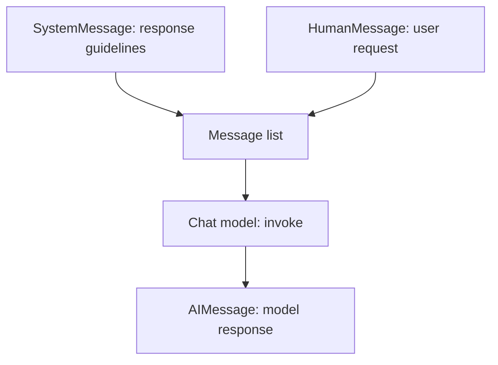

# Du texte aux messages LangChain

## Objectifs

À la fin de cette leçon, January saura :

- distinguer un texte simple d’un message associant un rôle et un contenu ; [5]
- lire une conversation représentée par des `SystemMessage`, `HumanMessage` et `AIMessage` ; [5]
- préparer des messages, les transmettre à un modèle de chat et lire le message retourné. [5]

## Prérequis

Aucun chapitre préalable n’est requis. Les trois notions centrales — **message**, **rôle** et **modèle de chat** — sont introduites ici.

Les exemples utilisent Python. Pour commencer, concentre-toi sur la représentation de la conversation : les textes, les types de messages et leur ordre. La documentation LangChain présente cette démarche en construisant une liste de messages avant de la transmettre au modèle. [5]

## L'essentiel en 5 lignes

- Un **message** représente une entrée ou une sortie du modèle et contient notamment un rôle et un contenu. [5]
- Le **rôle** identifie le type de contribution : instructions système, entrée utilisateur ou réponse du modèle, par exemple. [5]
- `SystemMessage`, `HumanMessage` et `AIMessage` représentent respectivement ces trois catégories. [5]
- Un **modèle de chat** peut recevoir une liste de messages avec `invoke` et renvoyer un `AIMessage`. [5]
- Une chaîne de caractères convient à une demande isolée ; une liste de messages permet de fournir un contexte conversationnel explicite. [5]

## Explication

### 1. Partir d’un texte simple

Imaginons une demande : « Résume ce paragraphe en une phrase. » Elle peut être représentée par une chaîne de caractères, c’est-à-dire du texte. LangChain permet de transmettre directement une telle chaîne à un modèle avec `invoke`, la méthode qui déclenche son appel. Cette forme convient à une requête autonome, sans historique de conversation. [5]

Mais une conversation peut comprendre une demande, une réponse, puis une précision. Pour représenter explicitement ces contributions et leurs rôles, LangChain propose des objets **messages**. Ces objets représentent les entrées et les sorties du modèle. [5]

Passer du texte aux messages consiste donc à préciser non seulement **ce qui est dit**, mais aussi **la fonction de chaque contribution** dans la conversation fournie au modèle. [5]

### 2. Définir le message et son contenu

Un **message** est une unité de contexte qui associe notamment un **rôle** et un **contenu**. Il peut aussi porter des métadonnées : des informations complémentaires, comme un identifiant ou des renseignements sur la réponse. [5]

Le **contenu** correspond à ce que le message transporte. Dans cette leçon, nous utiliserons uniquement du texte. Ce choix simplifie les exemples, mais ne constitue pas une limite générale : les messages peuvent aussi représenter des images, de l’audio ou d’autres contenus. [5]

Sépare donc deux questions :

- **Quel est le contenu ?** Par exemple, une phrase à traduire.
- **Quel est le rôle ?** Par exemple, une entrée de l’utilisateur. [5]

Le rôle n’est pas déduit uniquement des mots du contenu : il fait partie de la représentation du message. [5]

**Question de rappel :** deux messages contenant la même phrase ont-ils nécessairement le même rôle ? Non : le contenu et le rôle sont deux informations distinctes. [5]

### 3. Comprendre les rôles

Le **rôle** identifie le type de contribution représenté par le message. Pour lire nos premiers échanges, trois types suffisent. [5]

| Type LangChain | Fonction |
|---|---|
| `SystemMessage` | Fournit des instructions de comportement ou du contexte au modèle. [5] |
| `HumanMessage` | Représente une entrée de l’utilisateur. [5] |
| `AIMessage` | Représente une réponse de l’assistant. [5] |

Un `SystemMessage` peut définir le ton ou les consignes générales de réponse. Un `HumanMessage` fournit ensuite la demande à traiter. La réponse du modèle est représentée par un `AIMessage`. [5]

Ces types décrivent la fonction des messages, pas simplement la personne qui écrit le programme. Un programme peut ainsi construire explicitement un `AIMessage` pour représenter une réponse antérieure dans l’historique envoyé au modèle. La documentation montre cette utilisation. [5]

Ces trois catégories ne couvrent pas tous les cas. LangChain propose aussi `ToolMessage`, qui représente le résultat d’un appel d’outil. Nous n’utiliserons pas ce type dans cette leçon. [5]

**Question de rappel :** une phrase impérative est-elle nécessairement un `SystemMessage` ? Non : une demande utilisateur peut également contenir une instruction ; elle reste représentée par un `HumanMessage`. [5]

### 4. Définir le modèle de chat

Un **modèle de chat** traite une entrée conversationnelle et produit un message de réponse. Dans l’interface présentée ici, on lui transmet les messages avec `invoke`, puis on récupère un `AIMessage`. [5]

Le parcours comporte donc trois actions : préparer l’entrée, appeler le modèle et examiner la réponse. Le modèle peut être utilisé directement, sans construire un agent. [4][5]

`ChatOpenAI` est l’intégration LangChain utilisée ici pour accéder aux modèles OpenAI. Son utilisation nécessite le package correspondant et une clé d’API. Cette configuration concerne l’appel au fournisseur ; elle est distincte de la construction des objets messages. [3][5]

La réponse n’est pas seulement une phrase : c’est un objet message qui peut contenir du contenu et des métadonnées. Pour nos exemples textuels, nous lirons son attribut `content`. [5]

**Question de rappel :** après `response = model.invoke(messages)`, que représente `response` ? Le message retourné par le modèle, et non uniquement son texte. [5]

### 5. Représenter le contexte d’un appel

Une liste de messages représente les contributions fournies au modèle lors d’un appel. Elle peut inclure une instruction système, une demande utilisateur, une réponse antérieure et une nouvelle demande. [5]

Pour fournir un échange antérieur comme contexte, on l’inclut donc dans la liste transmise. Il faut distinguer cette représentation explicite d’une hypothèse de mémoire automatique : ici, nous raisonnons uniquement sur les messages envoyés à l’appel considéré. [5]

LangChain accepte notamment deux représentations : les objets messages et des dictionnaires comportant les champs `role` et `content`. Dans le format dictionnaire documenté, les correspondances sont les suivantes. [5]

| Objet message | Valeur du champ `role` |
|---|---|
| `SystemMessage` | `system` [5] |
| `HumanMessage` | `user` [5] |
| `AIMessage` | `assistant` [5] |

Nous garderons les objets messages dans le code pour rendre les trois types directement visibles. Cette représentation fait partie des formats présentés par la documentation. [5]

### 6. Fiche de référence

| Besoin ou notion | Décision à retenir |
|---|---|
| Demande autonome, sans historique | Une chaîne de caractères peut suffire. [5] |
| Instructions générales de comportement | Utiliser un `SystemMessage`. [5] |
| Entrée de l’utilisateur | Utiliser un `HumanMessage`. [5] |
| Réponse antérieure fournie comme contexte | La représenter avec un `AIMessage`. [5] |
| Plusieurs contributions à transmettre | Préparer une liste de messages. [5] |
| Appel au modèle | Employer `model.invoke(...)`. [5] |
| Lecture du résultat | Distinguer le message retourné de son contenu. [5] |

Dans le chapitre suivant, **Composer une chaîne de runnables**, nous étudierons comment transmettre la sortie d’une étape à l’entrée de la suivante. C’est le principe d’une `RunnableSequence`. Pour l’instant, retiens les messages qui entrent dans le modèle et celui qui en sort. [1][5]

## Schémas

Résultat attendu : le schéma montre deux messages regroupés en une entrée, puis transmis à un modèle qui produit un message de réponse. Il représente le parcours documenté pour un appel avec une liste de messages. [5]



Les nœuds représentent les messages, leur regroupement et l’appel au modèle. Les deux premières flèches indiquent la préparation de la liste ; les suivantes représentent sa transmission au modèle, puis la réception de la réponse. [5]

Lis le schéma de haut en bas : **préparer le contexte**, **appeler le modèle**, **lire son message de réponse**. Les messages système et utilisateur restent deux contributions distinctes dans l’entrée fournie. [5]

## Exemple travaillé

January prépare une aide à la traduction. Elle souhaite traduire une phrase anglaise en français en demandant uniquement la traduction. Nous séparerons l’instruction générale de la phrase à traiter, selon la démarche illustrée dans la documentation de `ChatOpenAI`. [3]

### Étape 1 — Préparer l’environnement

Résultat attendu : disposer des packages nécessaires pour utiliser LangChain avec l’intégration OpenAI. La documentation propose cette installation. [4]

```bash
pip install -U "langchain[openai]"
```

Ce bloc prépare l’environnement de l’exemple. Il ne demande pas encore de traduction : la configuration de l’accès et l’appel au modèle viennent ensuite. [3][4]

### Étape 2 — Construire les messages

Résultat attendu : construire deux messages et afficher le contenu fourni par l’utilisateur. Les types et l’accès au contenu suivent la représentation documentée par LangChain. [5]

```python
from langchain.messages import SystemMessage, HumanMessage

system_message = SystemMessage(
    "Translate English into French. Return only the translation."
)
human_message = HumanMessage(
    "The train leaves tomorrow morning."
)

messages = [system_message, human_message]

print(human_message.content)
```

L’affichage attendu est `The train leaves tomorrow morning.` Il correspond au contenu saisi dans cet exemple, et non à une réponse générée.

Le premier message définit le comportement demandé ; le second fournit la phrase à traiter. Cette séparation distingue l’instruction générale de l’entrée utilisateur, comme dans l’exemple de traduction de la documentation. [3]

### Étape 3 — Appeler le modèle et lire la réponse

Résultat attendu : obtenir un `AIMessage`, puis afficher son contenu. L’exécution nécessite une clé OpenAI valide et l’accès au modèle indiqué. [3][5]

```python
import getpass
import os

from langchain_openai import ChatOpenAI

if not os.environ.get("OPENAI_API_KEY"):
    os.environ["OPENAI_API_KEY"] = getpass.getpass(
        "Enter your OpenAI API key: "
    )

model = ChatOpenAI(model="gpt-5-nano")
response = model.invoke(messages)

print(response.content)
```

Lis l’affichage comme le **contenu du message retourné**. La traduction est le résultat demandé au modèle ; aucune formulation précise n’est présentée ici comme un résultat effectivement obtenu.

Pour comprendre le programme, distingue trois éléments : `messages` représente l’entrée, `invoke` effectue l’appel et `response` reçoit le message de réponse. L’attribut `content` donne accès à son contenu. [3][5]

## Erreurs fréquentes

### Confondre rôle et formulation

**Symptôme :** toute phrase impérative devient un `SystemMessage`.

**Explication :** le choix dépend de la fonction de la contribution. Les instructions générales de comportement peuvent figurer dans un message système ; les demandes de l’utilisateur sont représentées par des messages humains. [5]

### Attendre une simple chaîne en sortie

**Symptôme :** on traite le résultat de `model.invoke(messages)` comme s’il ne contenait que les mots de la réponse.

**Explication :** le résultat présenté par l’interface est un `AIMessage`. Son contenu est une partie de cet objet, qui peut aussi porter des métadonnées. [5]

### Omettre le contexte auquel la demande fait référence

**Symptôme :** la nouvelle demande renvoie à une réponse précédente, absente des messages transmis.

**Explication :** une liste de messages sert à fournir le contexte conversationnel de l’appel. Pour représenter l’échange antérieur dans cette entrée, il faut l’y inclure explicitement. [5]

### Confondre types d’objets et noms de rôles

**Symptôme :** on utilise `HumanMessage` comme valeur du champ `role` dans un dictionnaire.

**Explication :** le format dictionnaire documenté utilise `user` pour cette contribution. Les noms `HumanMessage` et `AIMessage` désignent les types d’objets, tandis que `user` et `assistant` sont les valeurs correspondantes dans ce format. [5]

## Exercice

Prépare une conversation pour une aide à la reformulation, **sans appeler de modèle**.

**Éléments fournis :**

- instruction générale : `Rewrite sentences in plain English.`
- première demande : `The meeting has been postponed.`
- réponse antérieure : `The meeting will happen later.`
- nouvelle demande : `Make it even shorter.`

Construis une liste nommée `messages` avec les types adaptés. La représentation d’une conversation avec une réponse antérieure suit les exemples de la documentation. [5]

**Résultat attendu :** quatre messages dans l’ordre donné, puis l’affichage du contenu de la nouvelle demande. Représente explicitement la réponse antérieure comme une contribution de l’assistant. [5]

Avant de coder, explique pourquoi cette réponse antérieure n’est pas un `HumanMessage`.

## Corrigé de l'exercice

L’instruction générale devient un `SystemMessage`. Les deux demandes deviennent des `HumanMessage`. La reformulation antérieure devient un `AIMessage`, car elle représente une réponse de l’assistant dans le contexte fourni. [5]

Résultat attendu : afficher `Make it even shorter.` Les vérifications intégrées contrôlent également la longueur de la liste et la représentation de la réponse antérieure.

```python
from langchain.messages import SystemMessage, HumanMessage, AIMessage

messages = [
    SystemMessage(
        "Rewrite sentences in plain English."
    ),
    HumanMessage(
        "The meeting has been postponed."
    ),
    AIMessage(
        "The meeting will happen later."
    ),
    HumanMessage(
        "Make it even shorter."
    ),
]

assert len(messages) == 4
assert isinstance(messages[2], AIMessage)
assert messages[-1].content == "Make it even shorter."

print(messages[-1].content)
```

L’affichage reprend le dernier contenu fourni. Il ne constitue pas une nouvelle reformulation : cet exercice construit seulement la représentation de la conversation.

Construire un `AIMessage` permet ici de représenter une réponse antérieure, comme dans les exemples d’historique documentés. Cela ne correspond pas à un nouvel appel au modèle. [5]

Pour vérifier le choix des types, relis chaque contribution : instruction générale, entrée utilisateur, réponse de l’assistant, puis nouvelle entrée utilisateur. Cette distinction justifie les quatre objets de la solution. [5]

## Sources

**Référence principale : [5]**, pour les messages, leurs rôles et les formats d’entrée.

- [1] [RunnableSequence](https://reference.langchain.com/python/langchain-core/runnables/base/RunnableSequence) — principe de composition présenté en transition.
- [3] [ChatOpenAI](https://docs.langchain.com/oss/python/integrations/chat/openai) — configuration et invocation de l’intégration OpenAI.
- [4] [Models](https://docs.langchain.com/oss/python/langchain/models) — installation et utilisation directe des modèles.
- [5] [Messages](https://docs.langchain.com/oss/python/langchain/messages) — définitions, types et représentation des conversations.

Les directives de navigation contenues dans les extraits ont été ignorées ; seul leur contenu documentaire a été exploité.

## Auto-évaluation

1. Quelles informations un message associe-t-il au contenu, contrairement à un simple texte ? [5]
2. Comment choisir entre `SystemMessage` et `HumanMessage` pour une phrase qui donne une instruction ? [5]
3. Que renvoie `model.invoke(messages)`, et quelle partie lis-tu avec `content` ? [5]
4. Comment représenter une réponse antérieure dans les messages transmis avec une nouvelle demande ? [5]
5. Quand une chaîne de caractères suffit-elle, et quand préférer une liste de messages ? [5]