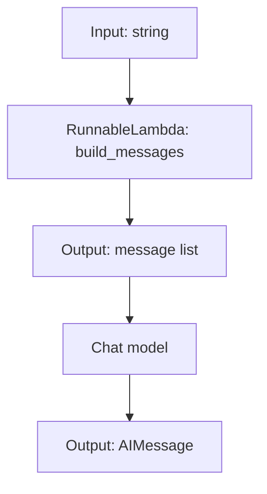

# Composer une chaîne de runnables

## Objectifs

À la fin de cette leçon, January saura :

- reconnaître un `Runnable` et choisir une méthode d’exécution adaptée ; [2]
- composer plusieurs étapes avec `|` pour obtenir une `RunnableSequence` ; [1]
- suivre les données d’une chaîne qui prépare des messages puis appelle un modèle de chat. [1][3]

## Prérequis

Aucun prérequis supplémentaire n’est demandé. Nous reprenons deux notions du chapitre **Du texte aux messages LangChain** :

- Un **message** représente une entrée ou une sortie de conversation. Il associe notamment un rôle et un contenu. `SystemMessage`, `HumanMessage` et `AIMessage` représentent respectivement des instructions système, une contribution utilisateur et une réponse du modèle. [3]
- Un **modèle de chat** peut recevoir une liste de messages avec `invoke` et renvoyer un `AIMessage`. Une chaîne de caractères convient aussi pour une demande isolée. [3]

Gardez cette distinction en tête : le message est une donnée ; le modèle est ici le composant qui traite cette donnée. [2][3]

## L'essentiel en 5 lignes

- Un `Runnable` est une unité de travail dotée d’une interface commune d’exécution et de composition. [2]
- `invoke` traite une entrée, tandis que `batch` traite plusieurs entrées. [2]
- Une `RunnableSequence` transmet la sortie de chaque étape à la suivante. [1]
- L’opérateur `|` permet de construire cette séquence, avec au moins un `Runnable` parmi ses deux opérandes. [1]
- Pour comprendre une chaîne, identifiez les données reçues et produites à chaque étape. [1][2]

## Explication

### 1. Reconnaître une étape exécutable

Un **`Runnable`** est une unité de travail composable : son interface permet notamment de traiter une entrée, plusieurs entrées ou une sortie progressive. Les composants partagent cette interface, sans nécessairement réaliser la même transformation. [2]

La méthode à retenir d’abord est **`invoke`**. Elle transforme une entrée en une sortie. La nature de ces données dépend du runnable utilisé. [2]

Pour intégrer une fonction Python dans une composition, nous pouvons l’envelopper dans **`RunnableLambda`**, comme le montrent les exemples de la documentation. [1][2]

**Résultat attendu :** le bloc affiche `5`. Il applique une fonction qui ajoute trois à son entrée, en passant par `invoke`. [2]

```python
from langchain_core.runnables import RunnableLambda

def add_three(number: int) -> int:
    return number + 3

add_step = RunnableLambda(add_three)

print(add_step.invoke(2))
```

Distinguez les responsabilités : `add_three` définit le calcul ; `add_step` expose ce calcul par l’interface des runnables. Dans cet exemple, l’entrée et la sortie sont des entiers. [2]

**Question de rappel :** quel objet possède la méthode `invoke` : la fonction ou le runnable qui l’enveloppe ?

### 2. Relier les étapes avec une `RunnableSequence`

Une **`RunnableSequence`** est une suite ordonnée de runnables dans laquelle chaque étape reçoit la sortie de la précédente. La sortie finale correspond donc au résultat de la dernière étape. [1]

L’opérateur **`|`** permet de construire cette séquence. Au moins l’un de ses deux opérandes doit être un `Runnable`. Pour rendre nos premières compositions explicites, nous envelopperons chacune de nos fonctions dans `RunnableLambda`. [1]

**Résultat attendu :** en reprenant `add_step`, cette chaîne affiche `20` : elle ajoute trois à deux, puis multiplie le résultat par quatre. [1][2]

```python
def multiply_by_four(number: int) -> int:
    return number * 4

multiply_step = RunnableLambda(multiply_by_four)
number_chain = add_step | multiply_step

print(number_chain.invoke(2))
```

Lisez la composition de gauche à droite. `multiply_step` reçoit `5`, et non l’entrée initiale `2`. La séquence elle-même peut être exécutée avec `invoke`, comme chacun de ses composants. [1][2]

Cette écriture décrit une composition déclarative : elle indique les composants à enchaîner et leur ordre. `RunnableSequence` prend en charge leur exécution successive. [1][2]

**Question de rappel :** quel résultat obtiendriez-vous en inversant les deux étapes ?

### 3. Vérifier les données entre deux étapes

La règle centrale découle du fonctionnement de la séquence : **la sortie d’une étape doit convenir comme entrée à la suivante**. Pour examiner une composition, identifiez donc ce que chaque composant reçoit et renvoie. [1][2]

Dans notre future chaîne conversationnelle, le parcours sera le suivant : une chaîne de caractères devient une liste de messages, puis cette liste est transmise au modèle, qui renvoie un `AIMessage`. [1][3]

Le type général ne suffit pas à décrire ce parcours : précisez également le contenu attendu. Ici, la liste préparée contiendra un message système et un message utilisateur, deux catégories reconnues par l’interface conversationnelle. [3]

Les runnables exposent aussi des schémas décrivant leurs entrées et leurs sorties. Ces informations permettent d’examiner leurs interfaces ; pour cette première composition, nous suivrons directement les valeurs intermédiaires avec `invoke`. [2]

**Question de rappel :** si une étape produit une liste de messages, que devez-vous vérifier avant de choisir l’étape suivante ?

### 4. Choisir comment exécuter la chaîne

Une séquence composée propose plusieurs méthodes : `invoke` traite une entrée, `batch` traite plusieurs entrées, et leurs variantes `ainvoke` et `abatch` sont asynchrones. [1][2]

**Résultat attendu :** ce bloc affiche `[16, 20, 24]`. Chaque nombre fourni est traité par la chaîne numérique complète. [1][2]

```python
print(number_chain.batch([1, 2, 3]))
```

Le premier résultat correspond à l’entrée `1`, le deuxième à `2`, et le troisième à `3`. Les éléments de la liste ne sont pas distribués entre les étapes : chacun traverse la séquence. [1][2]

Les méthodes `stream` et `astream` concernent la production progressive d’une sortie. Toutefois, cette progression dépend des composants : une étape sans méthode `transform` retarde le streaming jusqu’à la fin de son exécution. `RunnableLambda` ne fournit pas `transform` par défaut. Nous utiliserons donc `invoke` dans l’exemple principal. [1][2]

### 5. Fiche de référence

| Notion ou décision | À retenir |
|---|---|
| `Runnable` | Une unité de travail avec une interface d’exécution et de composition. [2] |
| `RunnableLambda` | Un moyen d’intégrer une fonction dans une composition. [1][2] |
| `RunnableSequence` | Un enchaînement où chaque sortie alimente l’étape suivante. [1] |
| `first | second` | Une écriture de la composition séquentielle. [1] |
| `invoke(input)` | Traite une entrée et renvoie une sortie. [2] |
| `batch(inputs)` | Traite plusieurs entrées. [2] |
| Vérification essentielle | Identifier les données reçues et produites à chaque liaison. [1][2] |
| Limite du streaming | Un composant sans `transform` peut retarder la sortie progressive. [1] |

## Schémas

**Résultat attendu :** ce schéma représente le parcours de notre chaîne conversationnelle, depuis une demande textuelle jusqu’au message renvoyé par le modèle. [1][3]



Les nœuds représentent soit une donnée, soit une étape de traitement. Les flèches indiquent le passage des données dans l’ordre d’exécution : la liste produite par `build_messages` devient l’entrée du modèle. [1][3]

Les nœuds consacrés aux données rendent les interfaces visibles ; ce ne sont pas des runnables supplémentaires. Notre chaîne comporte deux étapes exécutables : préparer les messages, puis appeler le modèle. [1][3]

## Exemple travaillé

### 1. Partir d’un besoin concret

January souhaite transformer une demande courte en conversation structurée, puis obtenir une réponse. Nous allons préparer les messages dans une première étape et appeler le modèle dans une seconde. Chaque runnable peut être invoqué seul avant d’être exécuté dans une composition. [1][2]

Nous choisissons ici `ChatOpenAI`. Cette intégration nécessite le package correspondant et une clé API, que nous rendrons disponible dans la variable d’environnement `OPENAI_API_KEY`. [4]

**Résultat attendu :** cette commande installe ou met à jour LangChain avec son intégration OpenAI, selon la forme d’installation présentée dans la documentation des modèles. [5]

```bash
pip install -U "langchain[openai]"
```

Cette étape prépare les packages utilisés ci-dessous. Elle ne lance pas encore d’appel au modèle. [4][5]

### 2. Préparer les messages

Nous plaçons le cadrage de la réponse dans un `SystemMessage` et la demande dans un `HumanMessage`, conformément à leurs rôles respectifs. [3]

**Résultat attendu :** après la saisie éventuelle de la clé, le bloc affiche `Explain what a runnable is.` : il s’agit du contenu du deuxième message préparé. [2][3][4]

```python
import getpass
import os

from langchain.messages import HumanMessage, SystemMessage
from langchain_core.runnables import RunnableLambda
from langchain_openai import ChatOpenAI

if not os.environ.get("OPENAI_API_KEY"):
    os.environ["OPENAI_API_KEY"] = getpass.getpass("OpenAI API key: ")

def build_messages(request: str) -> list:
    return [
        SystemMessage("Give a short explanation for a beginner."),
        HumanMessage(request),
    ]

prepare_step = RunnableLambda(build_messages)

messages = prepare_step.invoke("Explain what a runnable is.")
print(messages[1].content)
```

L’affichage permet d’examiner la préparation indépendamment : `prepare_step` reçoit une chaîne de caractères et produit une liste de deux messages. Aucun appel au modèle n’est exécuté dans ce bloc. [2][3]

### 3. Composer, puis invoquer

Le modèle accepte une liste de messages et produit un `AIMessage`. Il peut donc suivre notre étape de préparation, dont la sortie est précisément cette liste. [1][3][4]

**Résultat attendu :** le bloc affiche le contenu de la réponse générée. L’objet renvoyé par la chaîne est un `AIMessage` ; nous ne fixons pas ici de formulation exacte pour son contenu. [3][4]

```python
model = ChatOpenAI(model="gpt-5-nano")
chat_chain = prepare_step | model

reply = chat_chain.invoke("Explain what a runnable is.")
print(reply.content)
```

Suivez les valeurs : l’appel initial fournit une demande, `prepare_step` produit les messages, puis `model` reçoit cette liste. `reply` contient la sortie de la dernière étape, pas une collection des résultats intermédiaires. [1][3]

L’accès à `reply.content` lit le contenu du message. Ne généralisez toutefois pas cet exemple à tous les usages : les messages peuvent transporter des contenus autres qu’un texte simple. [3]

## Erreurs fréquentes

- **Symptôme : la deuxième étape ne peut pas exploiter son entrée.** La séquence lui transmet la sortie de l’étape précédente. Examinez cette sortie en invoquant le premier runnable seul, puis comparez-la à l’entrée attendue par le suivant. [1][2]

- **Symptôme : le traitement ne suit pas l’ordre prévu.** `first | second` exécute `first`, puis transmet son résultat à `second`. Inverser les composants inverse cet enchaînement. [1]

- **Symptôme : vous cherchez les messages préparés dans la réponse finale.** Notre chaîne renvoie le résultat du modèle, un `AIMessage`. Pour inspecter la préparation, appelez `prepare_step` séparément. [1][3]

- **Symptôme : l’appel à `ChatOpenAI` manque d’authentification.** L’intégration nécessite une clé API ; vérifiez sa disponibilité dans `OPENAI_API_KEY`. [4]

- **Symptôme : les fragments attendus arrivent seulement après une étape complète.** Un composant sans `transform`, notamment un `RunnableLambda` par défaut, peut retarder le streaming. [1]

## Exercice

Construisez une chaîne qui prépare une demande, puis relit son contenu, sans appeler de modèle.

Les éléments fournis sont `RunnableLambda`, `SystemMessage` et `HumanMessage`. Vous utiliserez deux fonctions : `build_messages(topic)` pour préparer les messages, puis `read_request(messages)` pour récupérer le contenu du dernier message. Cette organisation applique la transmission séquentielle des sorties. [1][3]

Respectez les contraintes suivantes :

1. Le message système contient `You explain technical concepts.`
2. Le message utilisateur suit la forme `Explain {topic} in one sentence.`
3. Chaque fonction est enveloppée dans un `RunnableLambda`.
4. La chaîne est construite avec `|`, puis exécutée avec `invoke`. [1][2]

**Résultat attendu :** pour l’entrée `runnables`, la sortie doit être exactement `Explain runnables in one sentence.`. C’est le contrat de l’exercice, et non une réponse générée.

## Corrigé de l'exercice

La première étape transforme le sujet en liste de messages. La seconde reçoit cette liste et lit le contenu du dernier message. Cette solution utilise uniquement des fonctions enveloppées dans des runnables. [1][2][3]

**Résultat attendu :** le programme affiche `Explain runnables in one sentence.` ; l’assertion vérifie l’égalité avec la valeur demandée. La composition repose sur `RunnableLambda` et `invoke`. [1][2]

```python
from langchain.messages import HumanMessage, SystemMessage
from langchain_core.runnables import RunnableLambda

def build_messages(topic: str) -> list:
    return [
        SystemMessage("You explain technical concepts."),
        HumanMessage(f"Explain {topic} in one sentence."),
    ]

def read_request(messages: list) -> str:
    return messages[-1].content

prepare_step = RunnableLambda(build_messages)
read_step = RunnableLambda(read_request)

request_chain = prepare_step | read_step

result = request_chain.invoke("runnables")

print(result)
assert result == "Explain runnables in one sentence."
```

Lisez la solution comme deux transformations successives : sujet vers liste de messages, puis liste de messages vers contenu utilisateur. La sortie finale provient de `read_step`, puisque cette étape termine la séquence. [1][3]

Pour vérifier chaque liaison, invoquez d’abord `prepare_step` seul et examinez ses messages. Transmettez ensuite cette liste à `read_step`, puis comparez avec le résultat de la chaîne complète. Vous utilisez ainsi la même interface `invoke` pour les composants isolés et leur composition. [1][2]

## Sources

**Référence principale : [1]**, pour la composition et le comportement de `RunnableSequence`.

Les invitations à naviguer présentes dans certains extraits ont été ignorées.

- [1] [RunnableSequence](https://reference.langchain.com/python/langchain-core/runnables/base/RunnableSequence)
- [2] [Runnable](https://reference.langchain.com/python/langchain-core/runnables/base/Runnable)
- [3] [Messages](https://docs.langchain.com/oss/python/langchain/messages)
- [4] [ChatOpenAI](https://docs.langchain.com/oss/python/integrations/chat/openai)
- [5] [Models](https://docs.langchain.com/oss/python/langchain/models)

## Auto-évaluation

1. Qu’est-ce qu’un `Runnable`, et à quoi sert sa méthode `invoke` ?
2. Dans `prepare_step | model`, quelle donnée le modèle reçoit-il ?
3. Comment vérifieriez-vous la sortie d’une étape avant de l’intégrer à une chaîne ?
4. Quelle différence faites-vous entre `chain.invoke(input)` et `chain.batch(inputs)` ?
5. Comment modifieriez-vous l’exercice pour récupérer le contenu du message système plutôt que celui du message utilisateur ?